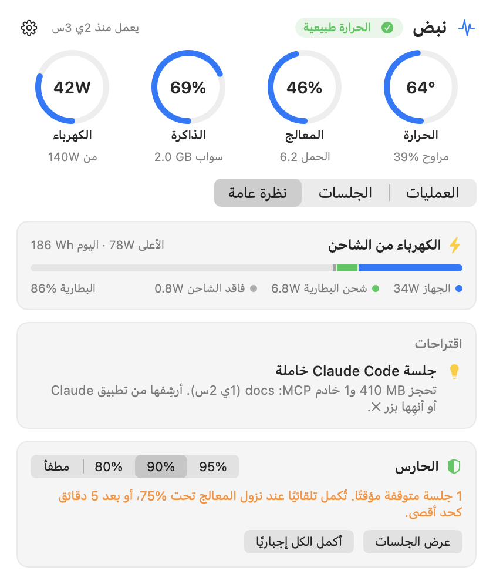
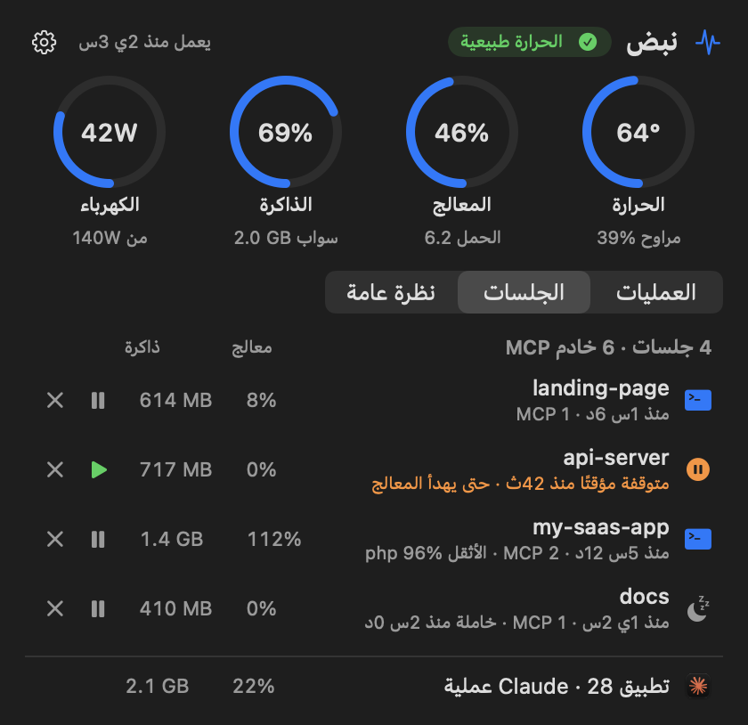
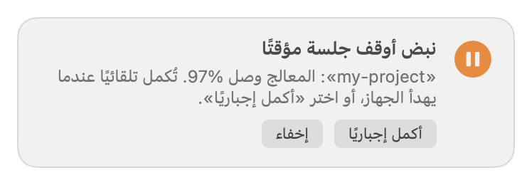
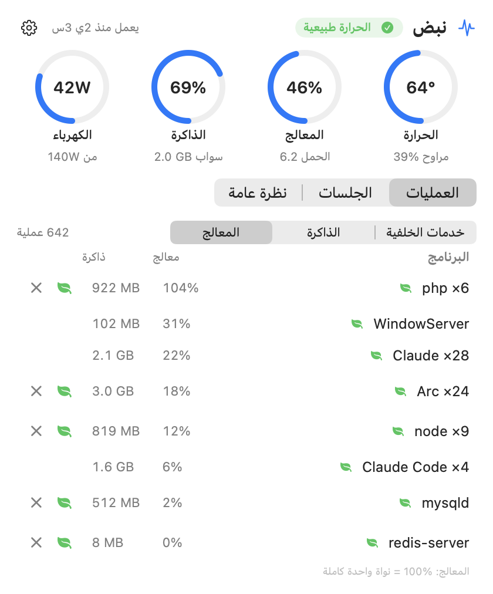

<div align="center">

# Nabd · نبض

**Your Mac's pulse in the menu bar — and a guard that keeps heavy Claude Code sessions from cooking it.**

Temperature · CPU · Memory · Power draw · Claude Code sessions


&nbsp;&nbsp;

</div>

<div dir="rtl">

## بالعربي

**نبض** تطبيق صغير لشريط القوائم في الماك يعرض الحرارة والمعالج والذاكرة واستهلاك الكهرباء، ويراقب جلسات
Claude Code: أي جلسة تستهلك أكثر، وأي جلسة خاملة، وكم خادم MCP يعمل. وفيه **حارس** يوقف أثقل جلسة مؤقتًا إذا
وصل المعالج إلى حدّ تختاره (90% افتراضيًا)، ويكملها تلقائيًا حين يهدأ الجهاز أو بضغطة «أكمل إجباريًا».

الواجهة بالعربي، ولا يحتاج `sudo`.

</div>

## Features

| | |
|---|---|
| 🌡 **Temperature** | CPU cores (average and hottest), GPU, SSD, battery, fan speed — straight from the SMC, no `sudo`. |
| ⚙️ **CPU & memory** | Total and per core type (performance / efficiency), load, memory pressure, swap. |
| ⚡ **Power** | Watts from the wall right now, split into the Mac itself, battery charging and charger loss; charger rating, peak, energy used today. |
| 🤖 **Claude Code** | Every session by project folder with its CPU, memory, MCP servers and heaviest child process; idle and orphaned ones are flagged. |
| 📊 **Top consumers** | By CPU, by memory, or background dev services (php, node, mysqld, nginx, redis, VMs…), with *calm* and *quit* buttons. |
| 💡 **Advice** | Plain-language hints: fans at max, swap too high, idle sessions, a charger too weak for the load… |
| 🛡 **Guard** | Pauses the heaviest Claude Code session when the CPU stays at the limit, then lets it continue. |
| 🪟 **Menu bar or window** | A popover from the menu bar, or the same panel in a normal window. |

## The guard

When the whole machine stays at or above the limit (80 / **90** / 95%, or off) for about 12 seconds, Nabd pauses
the session whose jobs burn the most CPU — the tests, builds and analysis its Bash commands started. The `claude`
process and its MCP servers are never touched, so the agent itself stays responsive.

<p align="center"></p>

- An alert with a **Force continue** button appears, with a sound.
- The session continues by itself once CPU drops 15 points under the limit (after at least 30 s, at most 5 min — sessions take turns).
- Force-continued sessions are left alone for 15 minutes. Any session can also be paused or continued by hand.
- Quitting Nabd resumes everything; after a crash it resumes what it had paused on the next launch.
- `nabd log` tells you what was paused or continued, and why.

> A paused session isn't told it is paused — its command just waits. If that lasts longer than Claude Code's
> command timeout, the command is killed and the agent sees a timeout. Time-sensitive tests may fail after a pause.

## Install

Requires macOS 13+ and Xcode or the Command Line Tools (`xcode-select --install`). Built and tested on an
Apple Silicon Mac (M1 Pro); Intel Macs should work but are untested.

```bash
git clone https://github.com/amjadArqan/nabd.git
cd nabd
./build.sh
cp -R Nabd.app /Applications/
open /Applications/Nabd.app
```

Nabd has no Dock icon: look for the pulse icon and readings in the menu bar. From the ⚙︎ menu you can open it in a
window and turn on **start with the Mac** (or run `nabd login on`). Opening Nabd again from Applications or
Spotlight while it runs also shows the window.

The build is ad-hoc signed, so macOS won't let it post system notifications — the guard uses its own alert instead.

<p align="center"></p>

## Command line

The app binary doubles as a CLI: `/Applications/Nabd.app/Contents/MacOS/Nabd <command>` (or `./nabd` after building).

| Command | |
|---|---|
| `nabd status` | Full report |
| `nabd doctor` | Advice only |
| `nabd line` | One line, e.g. `58°  CPU 40%  RAM 83%  43W` |
| `nabd json` | Everything as JSON |
| `nabd sensors` | Raw temperature sensors and fans |
| `nabd guard [limit]` | What the guard sees right now (dry run) |
| `nabd continue` | Force-continue every paused session |
| `nabd log` | Recent guard pauses and continues, with reasons |
| `nabd login [on\|off]` | Start with the Mac |
| `nabd window` | Launch with the panel in a window |
| `nabd calm` / `uncalm <pid\|name>` | Move a process tree to background priority (efficiency cores) and back |

## How it works

- **Temperatures and fans** — SMC via IOKit. Sensor keys are discovered at launch, so they adapt to the chip.
  Battery and SSD temperatures come from the HID sensor service (private API, loaded with `dlsym`).
- **Power** — the `AppleSmartBattery` registry entry (`PowerTelemetryData`, `AdapterDetails`).
- **Processes** — `ps` and libproc. Nabd only ever signals processes owned by you.
- One Swift file, no dependencies. Idle cost is about 0.5% of one core and ~50 MB of memory.

## Uninstall

```bash
/Applications/Nabd.app/Contents/MacOS/Nabd login off
rm -rf /Applications/Nabd.app
defaults delete local.nabd.monitor
```

## License

MIT © Amjad Arqan — see [LICENSE](LICENSE).
