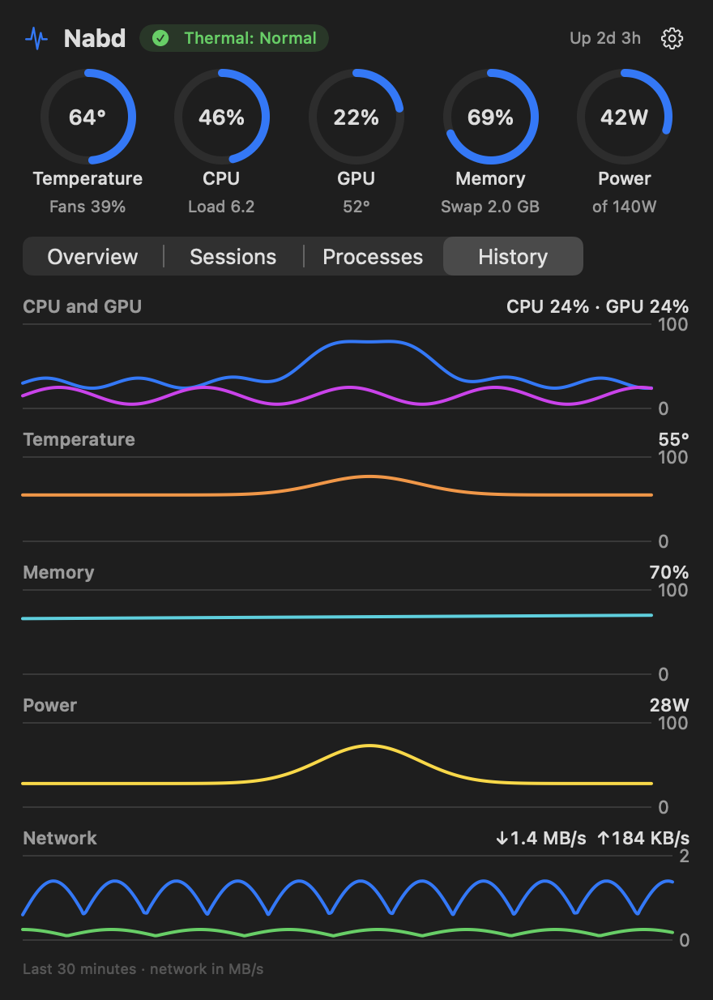
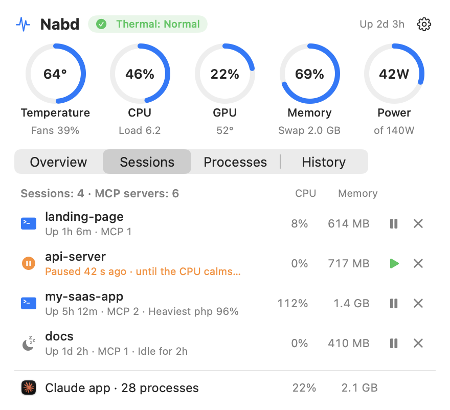
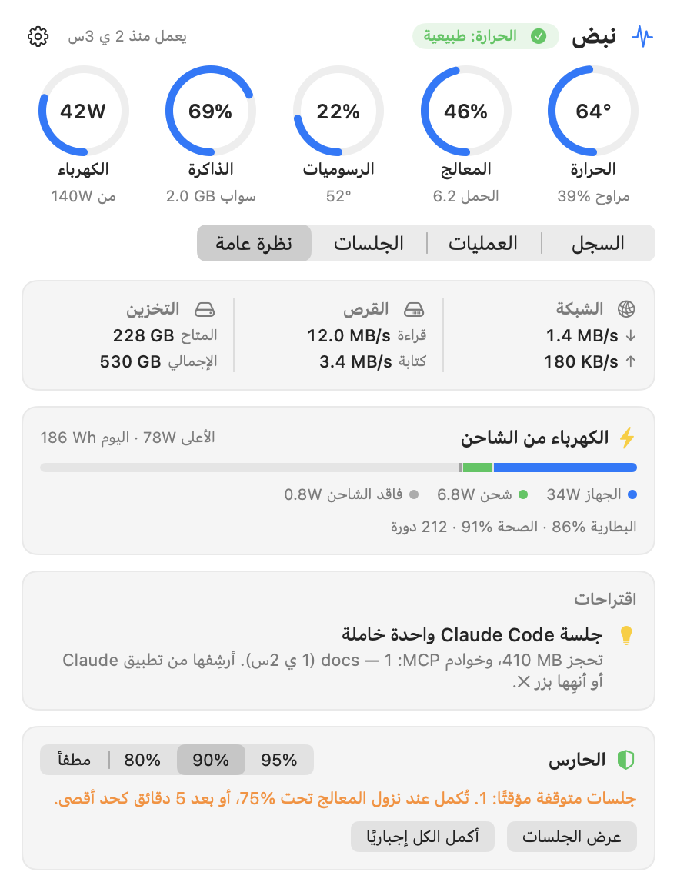

<div align="center">

# Nabd

**Your Mac's pulse in the menu bar — and a guard that keeps heavy Claude Code sessions from cooking it.**

Temperature · CPU · GPU · Memory · Network · Disk · Power · Claude Code sessions


**[⬇ Download Nabd.dmg](https://github.com/amjadArqan/nabd/releases/latest/download/Nabd.dmg)**

&nbsp;&nbsp;

</div>

## Features

| | |
|---|---|
| **Temperature** | CPU cores (average and hottest), GPU, SSD, battery and fan speed, read from the SMC — no `sudo`. |
| **CPU, GPU, memory** | Total CPU and per core type, load average, GPU utilization, memory pressure and swap. |
| **Network & disk** | Live download/upload and disk read/write speeds, free storage. |
| **Power** | Watts from the wall, split into the Mac itself, battery charging and charger loss; charger rating, peak, energy used today; battery health and cycle count. |
| **History** | Charts of the last 30 minutes: CPU and GPU, temperature, memory, power, network. |
| **Claude Code** | Every session by project folder with its CPU, memory, MCP servers and heaviest process; idle and orphaned ones are flagged. |
| **Top consumers** | By CPU, by memory, or background dev services (php, node, mysqld, nginx, redis, VMs…), with *calm* and *quit* buttons. |
| **Suggestions** | Plain-language hints: fans at full speed, swap too high, disk almost full, idle sessions, a charger too weak for the load… |
| **Guard** | Pauses the heaviest Claude Code session when the CPU stays at your limit, then lets it continue. |
| **Your menu bar** | Choose what shows next to the icon: temperature, CPU, GPU, memory, network, power — or just the icon. |
| **Menu bar or window** | A popover from the menu bar, or the same panel in a normal window. |
| **10 languages** | English, العربية, Deutsch, Español, Français, 日本語, 한국어, Português (Brasil), Русский, 简体中文 — follows your Mac's language, right-to-left included. |
| **Updates** | Checks GitHub once a day and shows a small *Update* button when a new version is out (can be turned off). |

<p align="center">&nbsp;&nbsp;</p>

## The guard

When the whole machine stays at or above the limit (80 / **90** / 95%, or off) for about 12 seconds, Nabd pauses
the session whose jobs burn the most CPU — the tests, builds and analysis its Bash commands started. The `claude`
process and its MCP servers are never touched, so the agent itself stays responsive.

<p align="center"></p>

- An alert with a **Force Continue** button appears, with a sound.
- The session continues by itself once the CPU drops 15 points under the limit (after at least 30 s, at most 5 min — sessions take turns).
- Force-continued sessions are left alone for 15 minutes. Any session can also be paused or continued by hand.
- Quitting Nabd resumes everything; after a crash it resumes what it had paused on the next launch.
- `nabd log` tells you what was paused or continued, and why.

> A paused session isn't told it is paused — its command just waits. If that lasts longer than Claude Code's
> command timeout, the command is killed and the agent sees a timeout. Time-sensitive tests may fail after a pause.

## Install

### Download

1. Download **[Nabd.dmg](https://github.com/amjadArqan/nabd/releases/latest/download/Nabd.dmg)** and drag **Nabd** into **Applications**.
2. Open it. Nabd isn't notarized by Apple, so macOS blocks the first launch: open **System Settings → Privacy & Security**,
   scroll down and click **Open Anyway**. Or, in Terminal:

   ```bash
   xattr -dr com.apple.quarantine /Applications/Nabd.app
   ```

One universal app for Apple Silicon and Intel, macOS 13 or later. Developed and tested on an M1 Pro with the latest macOS;
Intel Macs and older macOS versions are untested.

Nabd has no Dock icon: look for the pulse icon in the menu bar. From the ⚙︎ menu you can open it in a window, choose what
the menu bar shows and turn on **Start at Login**. Opening Nabd again from Applications or Spotlight shows the window.

### Build from source

Needs Xcode or the Command Line Tools (`xcode-select --install`).

```bash
git clone https://github.com/amjadArqan/nabd.git
cd nabd
./build.sh
cp -R Nabd.app /Applications/
```

`./release.sh` builds the universal app and packs `dist/Nabd.dmg` and `dist/Nabd.zip`.

## Command line

The app binary doubles as a CLI: `/Applications/Nabd.app/Contents/MacOS/Nabd <command>` (or `./nabd` after building).

| Command | |
|---|---|
| `nabd status` | Full report |
| `nabd doctor` | Suggestions only |
| `nabd line` | One line, e.g. `58°  CPU 40%  RAM 83%  43W` |
| `nabd json` | Everything as JSON |
| `nabd sensors` | Raw temperature sensors and fans |
| `nabd guard [limit]` | What the guard sees right now (dry run) |
| `nabd continue` | Force-continue every paused session |
| `nabd log` | Recent guard pauses and continues, with reasons |
| `nabd login [on\|off]` | Start at login |
| `nabd window` | Launch with the panel in a window |
| `nabd calm` / `uncalm <pid\|name>` | Move a process tree to background priority (efficiency cores) and back |

## Translations

English is the base language. The other nine were translated with AI and have not yet been reviewed by native
speakers — corrections are very welcome: edit `Localization/<language>.lproj/Localizable.strings` and open a pull request.
To add a language, copy `en.lproj`, translate the right-hand side, and add the language code to `CFBundleLocalizations`
in `Info.plist`.

## How it works

- **Temperatures and fans** — SMC via IOKit; sensor keys are discovered at launch, so they adapt to the chip.
  Battery and SSD temperatures come from the HID sensor service (private API, loaded with `dlsym`).
- **GPU** — the graphics driver's `PerformanceStatistics` in the IORegistry (undocumented, the same source other monitors use).
- **Network, disk** — interface counters (`getifaddrs`) and `IOBlockStorageDriver` statistics.
- **Power and battery health** — the `AppleSmartBattery` registry entry.
- **Processes** — `ps` and libproc. Nabd only ever signals processes owned by you.
- One Swift file, no dependencies. Idle cost is about 0.5% of one core and ~50 MB of memory.

## Ideas for later

Researched against [Stats](https://github.com/exelban/stats), iStat Menus and the Claude Code usage trackers
(ccusage-based menu bar apps): Claude Code token and cost tracking per project, threshold notifications
(temperature, memory), desktop widgets, a Homebrew cask, and a notarized build so macOS opens it without the extra step.

## Uninstall

```bash
/Applications/Nabd.app/Contents/MacOS/Nabd login off
rm -rf /Applications/Nabd.app
defaults delete local.nabd.monitor
```

## License

MIT © Amjad Arqan — see [LICENSE](LICENSE).
